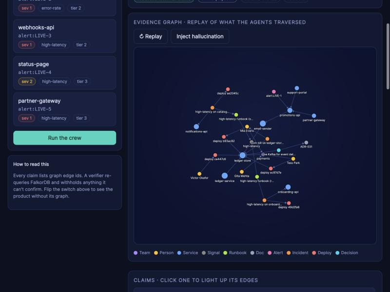

# TRACEBACK

**An incident-response agent crew that can't say anything it can't trace.**

TRACEBACK investigates production alerts with a team of AI agents. All the context the agents need (services and
their dependencies, who owns what, deploys, past incidents, runbooks, documents, decisions) lives in a **FalkorDB
graph database**. The agents' memory and the way they hand work to each other also live in that graph. Every
statement the system makes cites the exact graph edges that support it, and a verifier re-checks those edges against
the database and **withholds any claim it cannot confirm**.



## Is FalkorDB actually used?

Yes. It is the system of record, not a decoration:

| What | How FalkorDB is used |
|---|---|
| Company knowledge | Services, teams, people, deploys, alerts, incidents, documents, decisions are nodes; ownership, dependencies, authorship, causality are edges (with validity windows) |
| Every agent tool | 17 tools, each a Cypher query or graph algorithm (`algo.pageRank`, `algo.betweenness`, variable-length path traversals, vector search) |
| Agent memory | Episodes, tool calls, facts and runbook statistics are written back as nodes/properties |
| Multi-agent coordination | Agents communicate only through `Task` and `Finding` nodes; tasks are claimed with an atomic conditional `SET` |
| Verification | The verifier re-queries the graph by edge id to confirm each claim |
| Multi-tenancy | One graph per tenant (`t_helix`, `t_orbit`) inside one FalkorDB instance |

Proof that it's necessary, not just present: the console has a **FalkorDB graph ON/OFF** switch. With it off, the
system falls back to plain document retrieval and can no longer scope changes by dependency, find owners, hand off
work, or produce any verifiable claim (0% grounded). See [Results](#results) for the measured gap.

## What it does

When an alert fires, three agents run in sequence, coordinated through the graph:

1. **Triage** sizes up the alert (how many services depend on the failing one, how critical it is), opens an
   incident, and creates the work items.
2. **Investigator** walks the dependency graph to find the likely cause (a recent deploy to the alerting service or
   anything it depends on), the team that owns the culprit, the people who know it best, similar past incidents, and
   decisions that constrain it. It produces claims, and the verifier checks each one.
3. **Remediator** reads the Investigator's finding from the graph, picks the runbook with the best learned track
   record, proposes actions (page the expert, roll back the deploy, apply the runbook), gates risky ones behind human
   approval, and records the outcome so the next incident benefits.

Besides incidents, a **Company brain** view answers natural-language questions about the organisation
("Which teams own services that would be impacted if auth-service fails?") with sourced, verified answers.

## Features

### Incident investigation
- **Dependency-scoped root cause:** deploys are considered only if they hit the alerting service or something it
  depends on (up to 2 hops), ranked by proximity and recency. A "latest deploy anywhere" heuristic gets this wrong.
- **Blast radius and impacted teams:** transitive dependents of any service, and the teams that own them.
- **Expert finding:** people ranked by deploys authored plus incidents resolved on a service, restricted to people who
  are still on a team.
- **Similar incidents:** hybrid vector similarity + graph proximity (affected service within 2 hops).
- **Criticality and chokepoints:** PageRank and betweenness centrality over the dependency graph.
- **Orphaned ownership:** services owned by a team with nobody left.

### Proof-carrying answers ("no path, no claim")
- Every claim lists the graph edge ids behind it.
- The verifier accepts a claim only if the edges exist, were valid at that time, cited nodes exist with matching
  properties, **and every entity named in the text is an endpoint of the cited evidence** (so a language model cannot
  slip an ungrounded name into a grounded sentence).
- The console shows a *Grounded %* badge, replays the evidence subgraph the agents traversed, highlights a claim's
  edges when clicked, and has an **Inject hallucination** button that shows fabricated claims being withheld with
  reasons.

### Agent memory (all stored in the graph)
- **Episodic:** each agent run is an `Episode` with its `ToolCall`s, outcome and latency.
- **Semantic:** `Fact` nodes with validity windows; a new fact on the same topic closes the old one and links
  `SUPERSEDES`, so knowledge is updated, not overwritten. Time-travel queries ask "what was true on date X".
- **Procedural:** `Runbook` nodes carry attempt/success counters; ranking is a Cypher query over them. Outcomes are
  written back after each incident, so runbook choice improves over time (a learning curve is drawn in the console).

### Multi-agent coordination
- Task graph with dependencies (`BLOCKED_BY`), priorities, and findings (`PRODUCED`).
- Atomic claim: 100 workers racing for one task produce exactly one winner.
- Risk-scored actions (blast radius, tier, orphaned ownership) with a human-approval gate.

### Company brain
- Natural-language questions are routed to graph tools (rule-based intent parser; an LLM planner is optional) and
  answered with verified claims, shown side by side with a documents-only baseline.
- Time-aware: ownership, membership, dependencies and facts have validity windows, so stale documents lose to the graph.

### Operations
- **Tenant isolation:** separate graph per tenant; a canary test proves one tenant never sees the other's data even
  when service names overlap.
- **Concurrency:** client-side admission control and retry against FalkorDB's queue limit; benchmark included.
- **MCP server:** every tool is available to any MCP client (Claude Desktop, Cursor, custom agents).
- **Optional LLM:** with an Anthropic API key the Investigator uses Claude's tool-use loop and can rephrase claims;
  the verifier still gates every sentence. Without a key a deterministic playbook runs (fully offline).

## Technology stack

| Technology | Role in the project |
|---|---|
| **FalkorDB** (graph database, Redis protocol) | Stores all knowledge, memory and coordination state; runs traversals, vector search and graph algorithms |
| **Cypher** (OpenCypher subset) | Query language for every tool; see [QUERIES.md](QUERIES.md) |
| **FalkorDB vector index** | Cosine similarity over document and incident embeddings (`db.idx.vector.queryNodes`) |
| **FalkorDB algorithms** | `algo.pageRank` for criticality, `algo.betweenness` for single points of failure |
| **Python 3.11+** | Backend, agents, tools, verifier, evaluation |
| **`falkordb` Python client** (on redis-py) | Talks to FalkorDB; wrapped by `tbk/graph.py` for tenant routing and admission control |
| **FastAPI + Uvicorn + Pydantic** | HTTP API and static hosting of the console |
| **NumPy** | Dense/sparse retrieval math for the documents-only baseline |
| **MCP Python SDK** | Exposes the graph tools to MCP clients (stdio or streamable HTTP) |
| **Anthropic SDK** (optional) | Claude tool-use planner and claim rephrasing when `ANTHROPIC_API_KEY` is set |
| **Hashed text embeddings** (local) | Deterministic 256-dim embeddings; no network or API key needed |
| **React 18 + Vite** | Incident console |
| **d3-force** | Layout for the evidence-graph view (rendering is plain SVG) |
| **Docker / Docker Compose** | Runs FalkorDB and the app together |
| **pytest** | 32 tests: verifier, agents, isolation, MCP, LLM paths, evaluation |

## Setup

Requirements: **Docker**, **Python 3.11+**, **Node 18+** (and `uv` optionally).

### Option A: local development

```bash
cd traceback
make db        # starts FalkorDB: redis on :6390, FalkorDB Browser on http://localhost:3010
make setup     # creates .venv, installs Python and web dependencies
make seed      # generates the synthetic company and loads both tenants (about a second)
make web       # builds the React console into web/dist
make api       # serves API + console on http://localhost:8765
```

Open http://localhost:8765, pick an alert, click **Run the crew**.

### Option B: everything in containers

```bash
docker compose up --build      # FalkorDB + app; console on http://localhost:8765
```

### Configuration

Copy `.env.example` to `.env` (all optional):

| Variable | Default | Meaning |
|---|---|---|
| `FALKORDB_HOST` / `FALKORDB_PORT` / `FALKORDB_PASSWORD` | `localhost` / `6390` / none | FalkorDB connection (a managed FalkorDB Cloud instance works too) |
| `ANTHROPIC_API_KEY` | none | Enables the Claude planner and claim rephrasing |
| `TBK_LLM_MODEL` | `claude-sonnet-5-5` | Model used when a key is set |
| `TBK_TENANTS` | `helix,orbit` | Tenant graphs to use |
| `TBK_MAX_INFLIGHT` | `16` | Max concurrent queries per process |

### Everyday commands

```bash
make test       # run the 32 tests (needs FalkorDB up)
make eval       # graph agent vs documents-only baseline -> docs/EVAL.md
make bench      # concurrency benchmark -> docs/BENCH.md
make queries    # regenerate QUERIES.md from the source
make mcp        # MCP server over stdio
python -m tbk.isolation   # tenant-isolation canary test
```

MCP client configuration (Claude Desktop):

```json
{ "mcpServers": { "traceback": { "command": "/ABS/PATH/traceback/.venv/bin/python",
                                  "args": ["-m", "tbk.mcp_server"], "cwd": "/ABS/PATH/traceback" } } }
```

## Using the console

| Tab | What you can do |
|---|---|
| **Incident console** | Run the crew on a live alert; replay the evidence graph; click claims; inject a hallucination; approve risky actions; see tasks and what was learned |
| **Company brain** | Ask questions in plain language; compare the graph answer with the documents-only answer |
| **Agent memory** | See runbook statistics, facts with validity, recent episodes; re-run the learning simulation |
| **Proof** | Accuracy by hop depth, tenant-isolation test, concurrency numbers, the query catalogue |

The header has the tenant selector and the **FalkorDB graph ON/OFF** switch.

## Project layout

```
tbk/
  graph.py          tenant -> graph routing, admission control, retry
  switches.py       per-request graph kill switch
  tools/            17 graph tools (Cypher/algorithms) returning rows + evidence-bearing claims
  verifier.py       "no path, no claim"
  memory.py         episodes, tool calls, supersedable facts, incidents, actions
  tasks.py          task graph, atomic claim, handoff
  agents/           triage, investigator, remediator, company-brain Q&A, orchestrator
  llm.py            offline playbook planner and Claude tool-use planner
  seed/             deterministic synthetic company generator + bulk loader
  evalx/            evaluation questions, baseline reader, runner
  api/app.py        FastAPI app        mcp_server.py   MCP server
  bench.py, isolation.py, sim.py   concurrency benchmark, tenant canary, learning simulation
web/                React console
tests/              pytest suite
docs/               architecture, data model, API, evaluation, benchmark
```

More detail: [docs/ARCHITECTURE.md](docs/ARCHITECTURE.md) · [docs/DATA_MODEL.md](docs/DATA_MODEL.md) ·
[docs/API.md](docs/API.md) · [QUERIES.md](QUERIES.md) (generated from the code that runs them).

## Results

Measured on this repository's synthetic data (96 questions over 2 tenants). Both systems read the same documents with
the same embedder; the baseline is hybrid retrieval plus an extractive reader. Ground truth is computed from the data
generator's own model, never read back from FalkorDB.

| Relationships needed | Questions | Graph agent | Documents only |
|---|---|---|---|
| 1 hop | 28 | 100% | 89% |
| 2 hops | 14 | 100% | 29% |
| Time-travel (as-of) | 14 | 100% | 86% |
| 3+ hops | 40 | 100% | 10% |
| **All** | **96** | **100%** (100% grounded) | **47%** |

- **Concurrency** ([docs/BENCH.md](docs/BENCH.md)): 40 full agent crews at once run at about 19 incidents/s with every
  run fully grounded and no errors; 400 concurrent graph reads at about 340 ops/s; 100 workers racing for one task
  produce exactly one winner.
- **Learning:** over 240 simulated incidents (5 cold starts) the better runbook is picked 70% of the time in the first
  20 incidents and about 86% afterwards.
- **Isolation:** a canary planted in one tenant is invisible to the other.

How to read the graph agent's 100%: it shows the Cypher tools reproduce an independently computed model of the data.
It is a correctness check, not a claim of general reasoning ability.

## Limitations

- All data is synthetic and generated deterministically (`tbk/seed/generate.py`), including the "live" alerts.
- Runbook outcomes are simulated from hidden success rates; a real deployment would feed outcomes from monitoring.
- The default planner is a deterministic playbook. The Claude planner path is implemented and unit-tested with a
  scripted fake client but has not been run against the live API.
- The company-brain question router is rule-based, not an LLM.
- The baseline reader is extractive and deliberately competent; a stronger LLM reader would narrow the single-lookup
  gap but cannot reach documents that were not retrieved or facts that no document states.
- FalkorDB's Cypher is a subset of OpenCypher: `shortestPath` works only in `WITH`/`RETURN` and directed, no label
  expressions, and vector search does not combine with property filters. The tools are written around these limits.
- FalkorDB queues at most 25 queries by default; the client gates in-flight queries and retries (see `tbk/graph.py`).

## AI usage

This project was written with an AI coding assistant. See [AI_USAGE.md](AI_USAGE.md).
