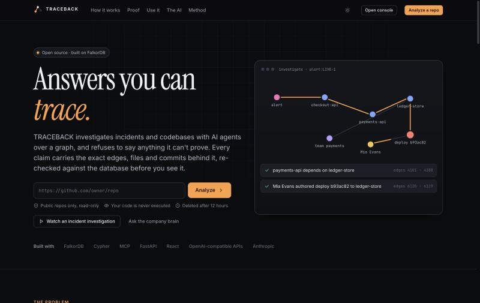
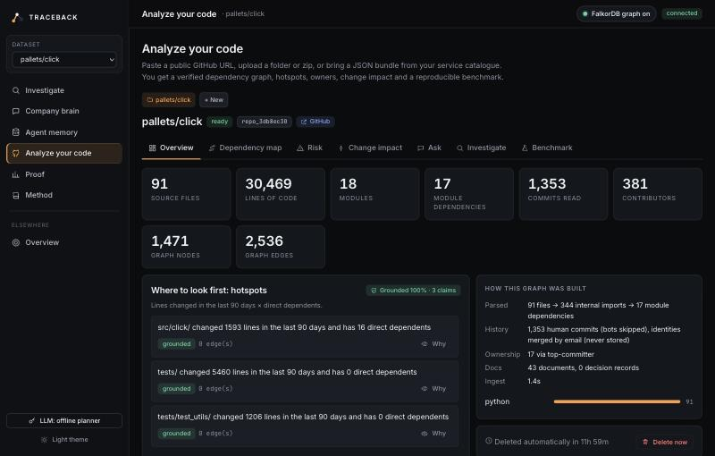
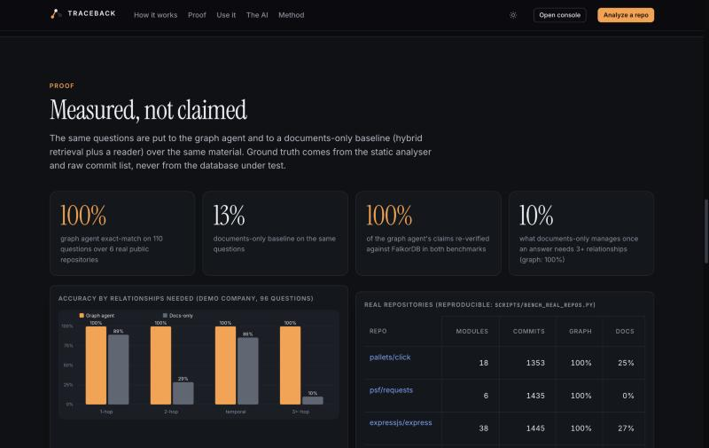

# TRACEBACK

**Answers you can trace.** AI agents that investigate incidents and codebases over a graph, and refuse to say anything
they can't prove.

TRACEBACK builds a **FalkorDB graph** from real sources (a GitHub repository, an uploaded folder, or your service
catalogue) and lets agents walk it: who depends on this module, who owns it, which change broke it, who should review
the fix. Every statement the system makes cites the exact graph edges behind it; a verifier re-queries the database
and **withholds any claim it cannot confirm**.



## Try it on your own code

```bash
make db seed web api          # then open http://localhost:8765
```

Paste `https://github.com/owner/repo` on the landing page (or **Analyze your code** in the console). In seconds you get:

| | |
|---|---|
| **Dependency map** | Real import graph (Python, JS/TS, Go, Java/Kotlin, C/C++), grouped into modules, sized by how many modules depend on each |
| **Hotspots** | Lines changed in the last 90 days × direct dependents: where changes hurt most |
| **Bus factor** | Modules where one person wrote most of the commits |
| **Change impact** | Pick a commit: what depends on it, who owns it, who should review it, a PR-ready markdown comment |
| **Ask** | "Which modules import `src/api/` directly?", "Who made the most commits to `lib/`?", full blast radius, ... |
| **Investigate** | The three-agent crew traces a reported regression to the likely commit, owner and reviewers |
| **Benchmark** | Auto-generated questions about *your* repo, graph agent vs a documents-only baseline |
| **Export report** | HTML (print to PDF) or Markdown: stats, hotspots, bus factor, criticality, impact, benchmark, all with evidence |

Sources: **GitHub URL** (public repos, read-only shallow clone), **folder / zip** upload (no `.git` is read), or a **JSON
bundle** exported from your service catalogue, deploy tool and pager. Details, privacy and the CI recipe:
[docs/REAL_WORLD.md](docs/REAL_WORLD.md).



From the terminal or CI:

```bash
python -m tbk.cli analyze https://github.com/pallets/click      # hotspots, bus factor, criticality (verified)
python -m tbk.cli impact . --base origin/main --head HEAD       # markdown PR comment with reviewers and risk
```

## Where the data comes from, and how claims are made

Nothing is taken on trust. Each relationship records **why it exists**:

| Edge | Created from | Provenance stored on the edge |
|---|---|---|
| `DEPENDS_ON` (module → module) | Static analysis of import statements | Up to 3 import sites as `file:line → file`, plus an import count |
| `AUTHORED`, `DEPLOYED_TO` (person → commit → module) | `git log --numstat` | `basis: git`, lines changed |
| `OWNS` (team → module) | `CODEOWNERS` (last matching rule wins); else top committer | The rule text, or `basis: top-committer` |
| `MEMBER_OF` | Inferred from who contributed to the modules a team owns | `basis: contributed-to-owned-modules` |
| `SUPERSEDES` (decision → decision) | "Supersedes ADR 0003" in ADR files | Link to the source document |

A **claim** is a sentence generated by a tool from those edges plus the edge ids. The verifier accepts it only if the
edges exist in this tenant's graph, were valid at that time, asserted properties still match, **and every entity named
in the text is an endpoint of the cited evidence** (so a model can't add "and billing-api is also down"). In the console
click **Why** on any claim to see each edge's basis: the import lines, the ownership rule, the commit. Grounded % counts
rejected claims against the score. Full write-up: the in-app **Method** page.

## Measured, not claimed

Same questions to the graph agent and to a **documents-only baseline** (hybrid dense + TF-IDF retrieval of 8 chunks, plus a
reader that parses the imports/ADRs/READMEs in what it retrieved) over the same material. **Ground truth comes from the
static analyser and the raw commit list (or the generator's own model), never from the database under test.**

**Real repositories**: cloned fresh, analysed, loaded and quizzed (`make bench-real`, [docs/BENCH_REAL.md](docs/BENCH_REAL.md)):

| Repository | Files | Modules | Module deps | Commits | Questions | Graph | Docs-only | Grounded |
|---|---|---|---|---|---|---|---|---|
| pallets/click (Python) | 91 | 18 | 17 | 1,353 | 16 | 100% | 25% | 100% |
| psf/requests (Python) | 37 | 6 | 3 | 1,435 | 10 | 100% | 0% | 100% |
| expressjs/express (JS) | 141 | 38 | 29 | 1,445 | 26 | 100% | 27% | 100% |
| spf13/cobra (Go) | 36 | 2 | 1 | 964 | 3 | 100% | 0% | 100% |
| gin-gonic/gin (Go) | 99 | 8 | 15 | 1,375 | 25 | 100% | 0% | 100% |
| tiangolo/fastapi (Python) | 1,172 | 97 | 160 | 619 | 30 | 100% | 10% | 100% |
| **All** | | | | | **110** | **100%** | **13%** | **100%** |

**Demo company** (synthetic, 96 questions, [docs/EVAL.md](docs/EVAL.md)): 1-hop 100% vs 89%, 2-hop 100% vs 29%, as-of 100% vs 86%,
3+ hops 100% vs 10%.

**Concurrency** ([docs/BENCH.md](docs/BENCH.md)): 40 full agent crews at once, ~19 incidents/s, all fully grounded, 0 errors; 100 workers racing
for one task produce exactly one winner. **Isolation**: a canary planted in one tenant is invisible to another.

How to read the 100%: it shows the Cypher tools reproduce an independently computed model of the data. The benchmark already
caught two real bugs (look-alike git author names collapsing into one person; path enumeration semantics on cyclic import
graphs), both fixed. The baseline's low scores come from seeing only 8 chunks; a long-context model reading a small repo would
narrow the gap on direct lookups, but cannot show its work and slows as repos grow.



## What the AI does (and doesn't)

The system works with **no model at all**. Everything below is deterministic code:

- parsing and ingest, graph construction, every Cypher query and FalkorDB algorithm,
- ranking (suspect scoring, hotspots, runbook success rates, risk), verification, and the benchmarks.

An **optional LLM** (your own keys; Anthropic natively or any OpenAI-compatible API: OpenAI, Gemini, Groq, OpenRouter,
Mistral, DeepSeek, local Ollama) has three narrow jobs: choose which tool to call next, answer free-form questions by
calling the same tools, and polish claim wording, after which the verifier rejects any added entity. It never decides what
is *true*, and it receives tool results (module names, authors, commit subjects, short doc snippets), not your source files.

**Bring your own keys, with failover.** Add several providers in the console (**LLM** button); if one hits a rate limit, runs
out of quota, is overloaded or rejects the key, the next takes over mid-investigation and the UI shows which answered. Keys
travel per request, are never stored or logged server-side, and live in the browser only if you tick "remember".

## Features

- **Investigations** (Triage → Investigator → Remediator) handing work through `Task`/`Finding` nodes with atomic claims; risk-gated actions with human approval; outcomes written back as episodic, semantic (facts with validity windows that supersede each other) and procedural (runbook statistics) memory.
- **Company brain**: natural-language questions routed to graph tools; time-aware (ownership, membership, dependencies, facts have validity windows).
- **Cycle-safe traversal**: blast radius, dependency paths and impacted teams use level-by-level expansion, so cyclic and dense real import graphs stay fast.
- **Multi-tenant**: one graph per tenant (demo companies and each upload), isolation proven by a canary test.
- **MCP server**: all 21 tools for Claude Desktop, Cursor or your own agent, each response carrying its verification.
- **Safe ingestion**: nothing is executed; zip-slip, symlinks, size bombs, `.git` in uploads, malformed URLs are rejected; per-address rate limit; workspaces deleted after 12 hours.
- **Graph controls and reports**: zoom in/out, reset, full screen and save-as-SVG on every graph; one-click **reports** for investigations, repository analyses and change impact as a self-contained HTML file (prints to PDF) or Markdown, with the evidence graph embedded.
- **Kill switch**: a header toggle disables the graph so you can see the product without it (0% verifiable).

## Technology

| Technology | Role |
|---|---|
| **FalkorDB** (Redis protocol) | The system of record: knowledge, memory, coordination state; traversals, vector search, `algo.pageRank`, `algo.betweenness` |
| **Cypher** | Every tool is a query; see [QUERIES.md](QUERIES.md) (generated from the code that runs them) |
| **Python 3.11+**, `falkordb` client | Backend, ingestion, agents, verifier, evaluation; `graph.py` adds tenant routing and admission control against FalkorDB's queue limit |
| **FastAPI / Uvicorn / Pydantic** | HTTP API (+ multipart uploads), static hosting of the console |
| **Static analysis**: `ast`, resolvers for JS/TS, Go, Java/Kotlin, C/C++ | Module graph with import sites |
| **git** (read-only) | History, authors, churn |
| **MCP Python SDK** | Tool server for MCP clients |
| **Anthropic SDK, httpx** (optional) | Claude and OpenAI-compatible providers with failover |
| **NumPy** | Dense/sparse retrieval for the documents-only baseline |
| **React 18, Vite, d3-force, fflate** | Console: landing, analysis lab, evidence graph (plain SVG), in-browser folder zipping |
| **Docker / Compose**, **pytest** (69 tests) | Packaging, verification |

## Setup

Requirements: Docker, Python ≥ 3.11, Node ≥ 18 (optional: `uv`).

```bash
cd traceback
make db        # FalkorDB: redis on :6390, FalkorDB Browser on http://localhost:3010
make setup     # venv + Python deps + web deps
make seed      # generate and load the two synthetic demo tenants (about a second)
make web       # build the console
make api       # API + console on http://localhost:8765
```

Or everything in containers: `docker compose up --build`.

| Variable | Default | Meaning |
|---|---|---|
| `FALKORDB_HOST` / `PORT` / `PASSWORD` | `localhost` / `6390` / none | FalkorDB connection (FalkorDB Cloud works) |
| `ANTHROPIC_API_KEY`, `OPENAI_API_KEY`, `GEMINI_API_KEY`, `GROQ_API_KEY`, `OPENROUTER_API_KEY`, `MISTRAL_API_KEY`, `DEEPSEEK_API_KEY` | none | Server-side default LLM providers (used after the user's own keys) |
| `TBK_ALLOW_CUSTOM_BASE_URL` | off | `1` lets users add a custom OpenAI-compatible endpoint (e.g. local Ollama) |
| `TBK_WORKSPACE_TTL_H`, `TBK_MAX_WORKSPACES`, `TBK_INGESTS_PER_HOUR` | 12 / 25 / 8 | Retention and abuse limits for uploaded workspaces |
| `TBK_MAX_UPLOAD_MB`, `TBK_MAX_TREE_MB`, `TBK_MAX_FILES`, `TBK_MAX_COMMITS`, `TBK_CLONE_TIMEOUT` | 100 / 250 / 25000 / 1500 / 150 | Ingestion limits |

Everyday commands: `make test` · `make eval` · `make bench` · `make bench-real` · `make queries` · `make mcp` · `make cli-demo`.

MCP client config (Claude Desktop):

```json
{ "mcpServers": { "traceback": { "command": "/ABS/PATH/traceback/.venv/bin/python",
                                  "args": ["-m", "tbk.mcp_server"], "cwd": "/ABS/PATH/traceback" } } }
```

## Project layout

```
tbk/
  ingest/        fetch (safe clone/zip), analyze (imports), history, codeowners, build (graph), bundle, pipeline
  workspaces.py  per-upload tenants, TTL, caps, rate limit
  tools/         21 graph tools (+ walk.py cycle-safe traversal) returning rows and evidence-bearing claims
  verifier.py    "no path, no claim"
  agents/        triage, investigator, remediator, company-brain Q&A, orchestrator
  providers.py   LLM adapters (Anthropic, OpenAI-compatible), failover, per-request keys
  llm.py         offline playbook planner and provider-agnostic LLM planner
  memory.py, tasks.py   episodes, facts, runbook stats, task graph and handoff
  evalx/         demo-company eval + real-repo benchmark (repo_eval.py)
  seed/          deterministic synthetic company
  api/app.py, mcp_server.py, cli.py
web/src/         landing, console (investigate, ask, memory, analyze lab, proof, method), design system
scripts/         bench_real_repos.py, gen_queries.py
docs/            REAL_WORLD, ARCHITECTURE, DATA_MODEL, API, EVAL, BENCH, BENCH_REAL
```

## Limitations

- Module dependencies come from static imports: dynamic imports, reflection, build-system and runtime dependencies are invisible.
- Ownership without CODEOWNERS is inferred from commits (and labelled). History is capped at the last 1,500 commits; uploads carry none.
- The demo company's alerts, deploys and runbook outcomes are synthetic (outcomes simulated from hidden success rates).
- The multi-provider LLM layer is tested with scripted providers and a fake OpenAI-compatible server end to end, not against live vendor APIs; default model names are editable.
- The company-brain question router is rule-based; the baseline reader is extractive and deliberately competent.
- FalkorDB's Cypher is a subset: `shortestPath` only in `WITH`/`RETURN` and directed (we use level-wise expansion), no label expressions, vector search doesn't combine with property filters.

## AI usage

This project was written with an AI coding assistant. See [AI_USAGE.md](AI_USAGE.md).
