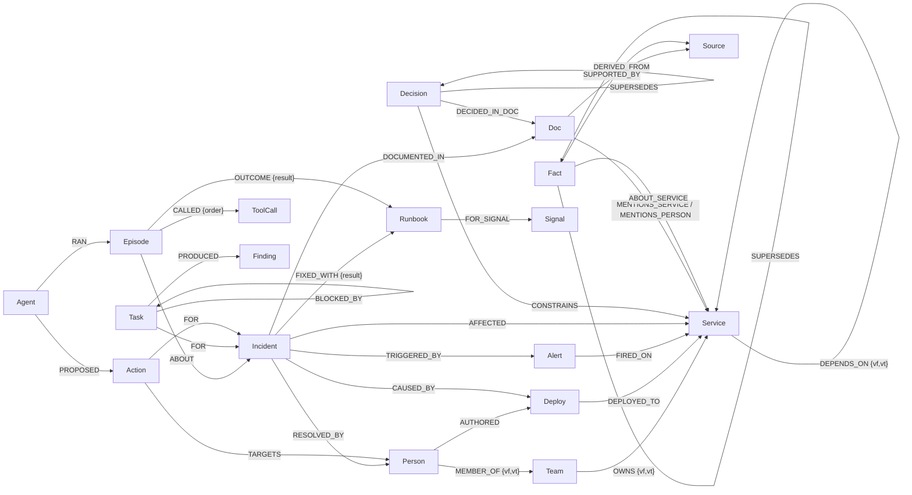

# Graph data model

One FalkorDB graph per tenant (`t_helix`, `t_orbit`). Time-varying relationships carry `vf` (valid from) and `vt`
(valid to; `4102444800` = open-ended), as epoch seconds. A query "as of t" keeps edges with `vf <= t < vt`.

## Nodes

| Label | Key properties | Role |
|---|---|---|
| `Service` | `id` (`svc:name`), `name`, `tier` 0-3, `layer`, `pr_score`, `bt_score` | topology; PageRank/betweenness are materialised by the algorithm tools |
| `Person`, `Team` | `id`, `name` | ownership and expertise |
| `Deploy` | `sha`, `ts`, `status` | change events |
| `Alert`, `Incident` | `ts`, `severity`, `signal`, `embedding` (Incident) | events; incidents are vector-indexed |
| `Doc`, `Source` | `kind` (readme/runbook/postmortem/adr/chat), `title`, `body`, `embedding` | knowledge; every `Doc` points to a `Source` (provenance) |
| `Decision`, `Fact` | `statement`/`text`, `vf`, `vt` | institutional memory with validity |
| `Runbook`, `Signal` | `attempts`, `successes`, `last_used` | procedural memory |
| `Agent`, `Episode`, `ToolCall` | `ts`, `goal`, `outcome`, `latency_ms`; `tool`, `args`, `n_claims` | episodic memory |
| `Task`, `Finding`, `Action` | `status`, `priority`; `payload` (JSON), `grounded_pct`; `risk`, `status` | coordination and acting |

Notes: FalkorDB has no label expressions, so "either/or" edge targets are separate relationship types
(`MENTIONS_SERVICE`, `MENTIONS_PERSON`, `ABOUT_SERVICE`, `ABOUT_PERSON`). Lists/maps are stored as JSON strings
where needed (`Finding.payload`, `ToolCall.args`).

## Indexes

Range index on `id` for every label; `Task.status`, `Deploy.ts`, `Alert.live`, `Doc.kind`, `Episode.ts`;
vector indexes (cosine, dim 256) on `Doc.embedding` and `Incident.embedding`. See `tbk/seed/load.py`.

## Planted facts (so evaluation and demos have something real to find)

6 ownership transfers (some READMEs left stale) · 4 services owned by a team with no remaining members · 8 dependency
edges ended mid-history · 12 decision chains (1-4 long) · 8 escalation-contact facts that supersede each other ·
8 signals × 2 runbooks with hidden success rates · 5 live alerts whose cause is one deploy 0-2 dependency hops away,
with in-scope older decoys and out-of-scope recent decoys (so "latest deploy overall" is wrong).
